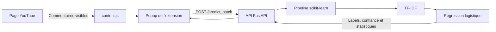
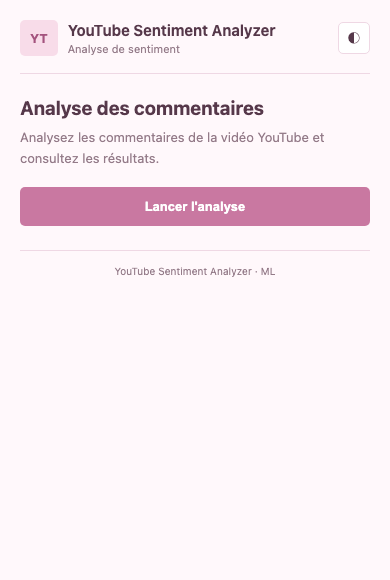
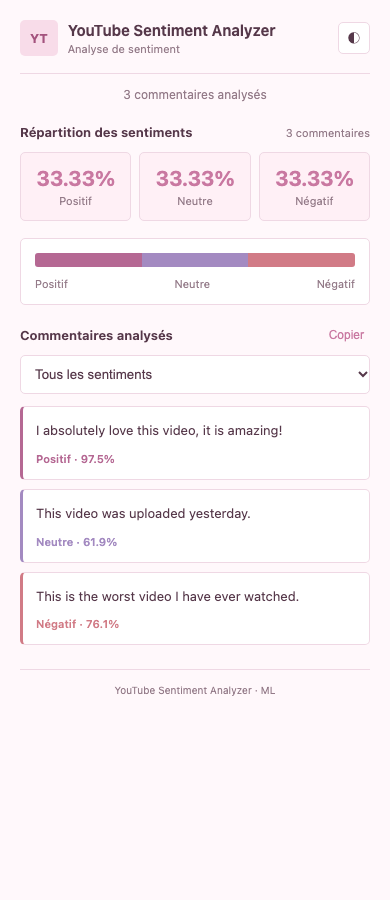
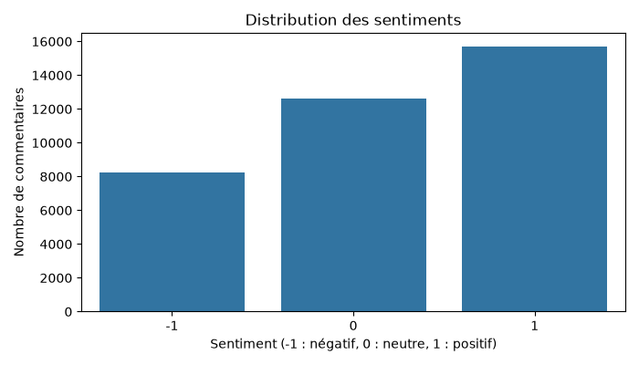
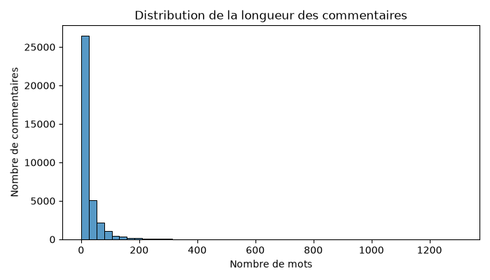

# YouTube Sentiment Analyzer

YouTube Sentiment Analyzer est une extension Chrome qui analyse les commentaires visibles sous une vidéo YouTube. Elle classe chaque commentaire comme positif, neutre ou négatif, puis affiche la répartition globale et le niveau de confiance du modèle.

Le projet regroupe toute la chaîne : préparation des données, entraînement du modèle, API de prédiction et interface utilisateur dans le navigateur.

## Fonctionnement

1. L'extension récupère les commentaires déjà chargés dans la page YouTube.
2. Le popup les envoie à l'API FastAPI avec une requête `POST /predict_batch`.
3. L'API utilise un pipeline TF-IDF + régression logistique pour prédire le sentiment.
4. L'extension affiche les résultats, les pourcentages par classe et le score de confiance de chaque prédiction.

Le modèle a été entraîné sur un jeu de commentaires Reddit en anglais. Les labels utilisés sont `-1` pour négatif, `0` pour neutre et `1` pour positif.

## Architecture technique



| Partie | Rôle | Technologies |
| --- | --- | --- |
| Données | Téléchargement, nettoyage, exploration et séparation train/test | pandas, requests, matplotlib, seaborn |
| Modèle | Vectorisation du texte et classification en trois sentiments | TF-IDF, LogisticRegression, scikit-learn |
| API | Chargement du modèle et prédiction par lot | FastAPI, Pydantic, Uvicorn |
| Extension | Extraction des commentaires et affichage des résultats | Chrome Extension Manifest V3, JavaScript, HTML, CSS |
| Déploiement | Construction d'une image légère pour l'API | Docker |

### Organisation du dépôt

```text
youtube-sentiment/
├── chrome-extension/       # popup et script d'extraction YouTube
├── models/                 # modèles entraînés au format joblib
├── reports/figures/        # graphiques d'exploration des données
├── src/
│   ├── api/                # application FastAPI
│   ├── data/               # préparation du jeu de données
│   └── models/             # entraînement et test d'inférence
├── Dockerfile
├── requirements.txt
└── requirements-prod.txt
```

## Installation

### Prérequis

- Python 3.11 ou une version plus récente
- Google Chrome ou Chromium
- Git

### Préparer l'environnement Python

```bash
git clone https://github.com/minlalapop/youtube-sentiment-analysis.git
cd youtube-sentiment-analysis

python3 -m venv venv
source venv/bin/activate

python -m pip install --upgrade pip
pip install -r requirements.txt
```

Sous Windows, l'activation de l'environnement se fait avec :

```powershell
venv\Scripts\activate
```

Le fichier `models/balanced.joblib` est déjà présent dans le dépôt, il n'est donc pas nécessaire de réentraîner le modèle pour lancer l'API.

## Utilisation

### 1. Lancer l'API

Depuis la racine du projet :

```bash
uvicorn src.api.app:app --reload --host 127.0.0.1 --port 8000
```

Vérifier que le modèle est chargé :

```bash
curl http://127.0.0.1:8000/health
```

Réponse attendue :

```json
{"status":"ok","model":"loaded"}
```

La documentation interactive de l'API est disponible sur [http://127.0.0.1:8000/docs](http://127.0.0.1:8000/docs).

### 2. Tester une prédiction sans l'extension

```bash
curl -X POST http://127.0.0.1:8000/predict_batch \
  -H "Content-Type: application/json" \
  -d '{"comments":["I love this video","This is a video","This is terrible"]}'
```

L'API renvoie le sentiment, le score de confiance et les statistiques globales pour le lot de commentaires.

### 3. Installer l'extension Chrome

Pour une utilisation locale, vérifier que `API_URL` dans `chrome-extension/popup.js` pointe vers :

```javascript
const API_URL = "http://127.0.0.1:8000/predict_batch";
```

Ensuite :

1. Ouvrir `chrome://extensions` dans Chrome.
2. Activer le **Mode développeur**.
3. Cliquer sur **Charger l'extension non empaquetée**.
4. Sélectionner le dossier `chrome-extension` du projet.
5. Ouvrir une vidéo YouTube et faire défiler la page pour charger des commentaires.
6. Ouvrir l'extension puis cliquer sur **Lancer l'analyse**.

L'extension analyse uniquement les commentaires déjà présents dans la page. Si aucun commentaire n'est détecté, il faut faire défiler la section des commentaires puis relancer l'analyse.

Pour utiliser une API distante, modifier `API_URL` et ajouter le domaine correspondant dans `host_permissions` du fichier `chrome-extension/manifest.json`.

### Lancer avec Docker

```bash
docker build -t youtube-sentiment-api .
docker run --rm -p 8000:7860 youtube-sentiment-api
```

L'API reste ensuite accessible sur `http://127.0.0.1:8000`.

## Démonstration

### Popup de l'extension



### Résultat d'une analyse

Cette capture utilise trois phrases réellement passées dans le modèle inclus dans le dépôt.



### Exploration du jeu de données





## Reproduire l'entraînement

Les scripts sont conçus pour être exécutés depuis la racine du projet, dans cet ordre :

```bash
python src/data/download_data.py
python src/data/prepare_data.py
python src/data/split_data.py
python src/data/explore_data.py
python src/models/train_model.py
```

Le dernier script entraîne le pipeline et remplace `models/balanced.joblib`. Pour mesurer le temps d'inférence sur des lots de 50 commentaires :

```bash
python src/models/test_inference.py
```

## Limites connues

- Le modèle est entraîné sur des commentaires Reddit en anglais : les résultats peuvent être moins fiables sur du français, des emojis ou du vocabulaire propre à YouTube.
- Seuls les commentaires chargés dans le DOM de la page sont récupérés.
- Le score de confiance correspond à la probabilité maximale produite par le classifieur ; il ne garantit pas que la prédiction est correcte.
- Le modèle ne tient pas compte du contexte d'une conversation ni du sarcasme.
